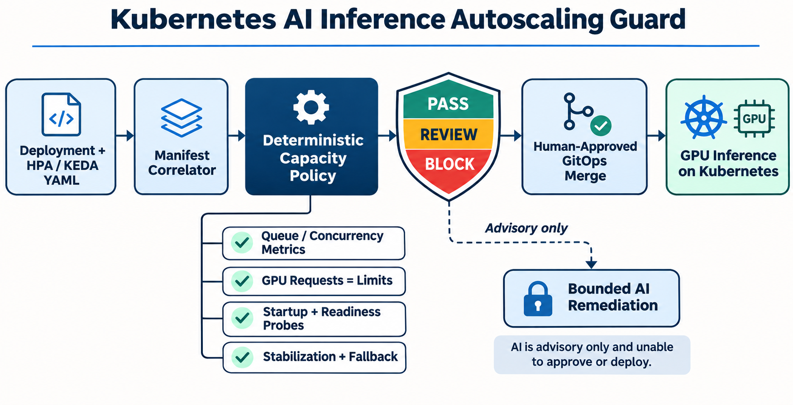

# Kubernetes AI Inference Autoscaling Guard

A deterministic GitOps policy gate for GPU inference workloads, HorizontalPodAutoscalers, and KEDA ScaledObjects. It catches capacity-control defects before merge: CPU-only scaling, missing GPU allocation, absent readiness controls, unsafe replica ranges, short cooldowns, and missing metric-source fallback.



## Production problem

GPU inference services can meet average demand and still fail under burst traffic because model loading is slow, queue depth rises before CPU does, and aggressive scale-down causes expensive replica churn. The guard turns operational assumptions into reviewable policy without letting AI control production capacity.

Current demand and authoritative sources are documented in [`docs/research.md`](docs/research.md).

## What it checks

- AI inference workloads are explicitly labeled and declare a p95 latency objective.
- GPU requests and limits exist and match.
- Startup and readiness probes protect cold-starting replicas.
- Every workload has an HPA or KEDA ScaledObject.
- HPA uses `autoscaling/v2`, valid capacity bounds, demand-aware metrics, and scale-down stabilization.
- KEDA uses valid bounds, cooldown, fallback capacity, and non-resource-only triggers.
- Decisions are deterministic: `PASS`, `REVIEW`, or `BLOCK`.

AI is advisory only. It can explain findings and draft a minimal patch, but cannot change SLOs or capacity, approve a merge, or deploy.

## Quick start

```bash
python -m venv .venv
source .venv/bin/activate
pip install -e . pytest
pytest
inference-autoscaling-guard samples/compliant-hpa.yaml --output json
```

The compliant sample returns a score of 100 and `PASS`.

## Architecture

1. Pull-request YAML enters the manifest correlator.
2. AI inference Deployments are matched to HPA or KEDA resources.
3. Deterministic policy checks GPU scheduling, probes, metrics, capacity bounds, stabilization, and fallback.
4. CI emits `PASS`, `REVIEW`, or `BLOCK` plus remediation evidence.
5. Optional AI explains findings without enforcement authority.
6. Only a human-approved GitOps merge reaches production Kubernetes.

## Validation

The unit suite covers a compliant HPA, missing autoscaler, missing or mismatched GPU allocation, missing probes, obsolete HPA API, invalid capacity bounds, CPU-only metrics, short stabilization, and missing SLO evidence. GitHub Actions installs the package, runs all tests, and validates the sample.

## Deployment and failure modes

Adopt it read-only first, baseline existing workloads, protect SLO/policy changes, validate metric outages and GPU quota in staging, and retain reports. A passing manifest cannot prove metric freshness, node provisioning latency, image-pull performance, or model-load time. See [`docs/deployment.md`](docs/deployment.md).

## Measurable outcomes

Track p95 latency, queue age, scale-up time, cold starts, GPU utilization, idle-GPU minutes, cost per successful inference, replica flapping, metric failures, fallback activations, and autoscaling-policy false positives.

## Trade-offs

- Queue or concurrency metrics usually represent inference demand better than CPU, but require a dependable metrics pipeline.
- Longer stabilization reduces churn but can hold costly GPU capacity longer.
- Minimum replicas improve latency but reduce scale-to-zero savings.
- Static policy catches configuration defects; load testing remains necessary for thresholds.

## Interview positioning

This project demonstrates Kubernetes autoscaling, GPU workload operations, custom metrics, SRE trade-offs, policy-as-code, CI/CD, test design, secure AI boundaries, and FinOps-aware capacity management. The strongest story is balancing latency, reliability, and GPU cost while keeping enforcement deterministic and production authority human-controlled.

## License

MIT
