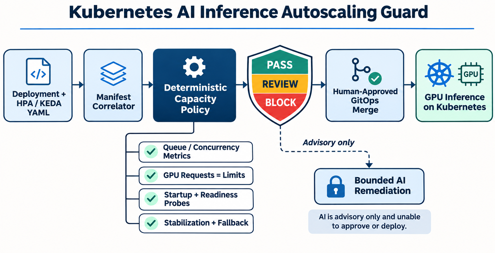

# Governing Kubernetes Autoscaling for GPU Inference Workloads

AI inference capacity often fails at the control loop rather than the model. CPU can remain moderate while request queues grow, GPU replicas can take minutes to load weights, and fast scale-down can trigger repeated cold starts. The result is a combined SRE and FinOps problem: latency rises while expensive capacity churns.

I built **Kubernetes AI Inference Autoscaling Guard** to validate those controls before GitOps merge.

## Why this matters now

Current AI-platform roles repeatedly combine Kubernetes, GPU scheduling, autoscaling, observability, and reliability. Kubernetes HPA supports custom and external metrics plus stabilization controls. KEDA adds event-driven triggers, cooldown, and fallback behavior. Those features are powerful, but a production-safe configuration still depends on reviewable policy.

## Architecture and implementation

The Python engine parses multi-document YAML, finds Deployments labeled as AI inference, correlates each with an HPA or KEDA ScaledObject, and emits `PASS`, `REVIEW`, or `BLOCK`.

It validates GPU requests and limits, startup/readiness probes, p95 latency evidence, autoscaler API and capacity bounds, demand-aware metrics, scale-down stabilization, KEDA cooldown, and metric-source fallback.

AI is a separated advisory branch. It may explain findings and draft a minimal patch, but cannot change SLOs, capacity, policy, merge approval, or production.

## Tests and validation

The unit suite covers the compliant path and nine material failure modes. GitHub Actions installs the package, runs the tests, and requires the compliant sample to score 100 with a `PASS` decision.

## Deployment guidance

Start read-only in pull requests. Baseline existing workloads, protect policy and SLO changes, test metric outages, and measure node provisioning, image pull, and model-load behavior in staging. Promote deterministic blocks to required checks only after reviewing false positives.

## Security and reliability considerations

The tool performs no cluster mutation. A passing manifest does not prove metric freshness, GPU quota, scheduler capacity, or model readiness. KEDA fallback protects against metric-source failure, while stabilization limits flapping. Human approval remains the only path to deployment.

## Measurable outcomes

Measure p95 latency, queue age, scale-up time, cold starts, GPU utilization, idle-GPU minutes, cost per successful inference, replica flapping, metric failures, fallback activations, and policy false positives.

## Trade-offs and lessons

Queue-aware metrics better reflect demand but add telemetry dependency. Longer stabilization reduces churn but holds GPU capacity. Minimum replicas improve latency while reducing scale-to-zero savings. Static validation catches configuration defects, but load testing must still set thresholds.

## Interview positioning

This project demonstrates Kubernetes autoscaling, custom metrics, GPU operations, SRE/FinOps trade-offs, CI/CD, policy-as-code, test design, and bounded AI. The design decision worth discussing is the authority boundary: deterministic policy enforces reviewable facts, while humans own production capacity.

Repository: https://github.com/ohjeffkuston/kubernetes-inference-autoscaling-guard
